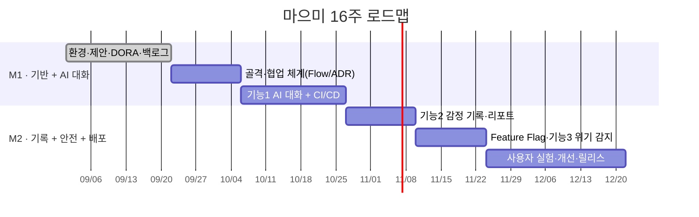

# 🌱 마으미 (Maeumi) — 프로젝트 제안서

> **AI 기반 마음 돌봄 & 감정 기록 앱**
> 오픈소스SW 학기 프로젝트 · 개인 프로젝트 · 황서현 ([@hwsseo](https://github.com/hwsseo))

---

## 1. 프로젝트 개요

| 항목 | 내용 |
|---|---|
| 프로젝트명 | **마으미 (Maeumi)** |
| 한 줄 소개 | 하루의 마음을 AI와 대화하며 털어놓고, 감정 변화를 스스로 돌아볼 수 있게 돕는 모바일·웹 앱 |
| 형태 | 개인 프로젝트 (2026년 2학기, 16주) |
| 대상 사용자 | 상담센터에 가기엔 부담스럽지만 마음을 정리할 곳이 필요한 대학생·청년 |

## 2. 문제 정의

**① 마음을 털어놓을 "가벼운 첫 창구"가 없다**
상담센터는 예약·대기·심리적 부담 때문에 문턱이 높고, 친구에게는 매번 털어놓기 어렵다. 그 결과 스트레스가 쌓여도 정리하지 못하고 넘기는 경우가 많다.

**② 내 감정이 어떻게 변하는지 돌아볼 수 없다**
일기나 메모를 써도 흩어져 있어서 "요즘 왜 이렇게 지치지?"를 데이터로 확인하기 어렵다. 감정의 패턴(요일·사건·시간대)을 알면 스스로 대처할 수 있지만, 그런 도구는 대부분 유료이거나 기록이 번거롭다.

**③ AI 대화 앱은 위험 신호를 놓칠 수 있다**
일반 챗봇은 사용자가 심각한 위기 표현을 해도 일반 대화처럼 응답할 수 있다. 마음 돌봄 서비스라면 **위험 상황을 감지해 실제 도움(전문 기관)으로 연결하는 안전장치**가 필수다.


## 3. 핵심 기능 (3개)

### 🗣️ 기능 1. AI 마음 대화
- 사용자가 오늘 있었던 일·기분을 채팅으로 이야기하면 AI(Google Gemini Flash)가 공감하고 정리해 준다.
- **API 키는 서버(FastAPI)에서만 관리**하고, 앱은 서버를 거쳐 호출한다. (키 노출 방지)
- AI 호출 실패·한도 초과 시 미리 준비한 기본 응답으로 자동 대체(Fallback)한다.
- 대화 톤(공감형 / 정리형)을 선택할 수 있다. → *11주차 Feature Flag, 13주차 A/B 실험 대상*

### 📊 기능 2. 감정 기록 & 주간 마음 리포트
- 대화가 끝나면 그날의 감정(기쁨·평온·불안·슬픔·분노 등)과 강도를 기록한다. (AI 자동 분류 + 사용자 수정)
- 주간 리포트: 감정 분포·변화 그래프, 가장 많이 언급한 고민 키워드, 한 줄 회고를 보여 준다.
- 데이터는 SQLite에 저장하며, 사용자가 언제든 **자기 기록을 내보내기/삭제**할 수 있다.

### 🆘 기능 3. 위기 신호 감지 & 도움 기관 연결
- 대화 중 자해·자살 등 위험 표현이 감지되면 일반 응답 대신 **안내 화면**을 우선 표시한다.
- 자살예방상담전화 **109**, 정신건강위기상담 **1577-0199**, 학교 학생상담센터 등으로 바로 연결(전화 걸기 버튼).
- 감지 규칙(키워드 + AI 분류)을 **테스트 케이스로 관리**해 오탐·미탐을 지속적으로 줄인다. → *12주차 테스트 자동화와 연계*

## 4. 기술 스택

| 구분 | 기술 | 선택 이유 |
|---|---|---|
| 클라이언트 | **Flutter (Dart)** | 하나의 코드로 Android·Web 동시 지원 → 10주차 멀티 플랫폼 배포 |
| 서버 | **FastAPI (Python)** | 가볍고 빠르며, 자동 API 문서(Swagger) 제공 |
| 데이터베이스 | **SQLite** | 개인 프로젝트 규모에 적합, 별도 서버 불필요 |
| AI | **Google Gemini API (Flash, 무료 등급)** | 비용 없이 자연스러운 한국어 대화 가능 |
| 협업·관리 | **Git, GitHub, GitHub Projects** | 이슈·칸반·마일스톤 기반 개발 |
| CI/CD | **GitHub Actions** | 테스트·빌드·배포 자동화, DORA 지표 수집 |
| 패키징·배포 | **Docker, GitHub Packages(GHCR), GitHub Pages** | 서버 컨테이너화, 웹 버전 배포 |
| 테스트 | **pytest, flutter_test** | 서버·앱 단위 테스트 |
| 보안 | **Dependabot, CodeQL, GitHub Secrets** | 의존성 취약점 점검, API 키 안전 보관 |

```
[ Flutter 앱 (Android / Web) ]
            │  HTTPS
            ▼
[ FastAPI 서버 ] ── 위기 감지 모듈 ── 109 / 1577-0199 안내
     │        │
     ▼        ▼
 [SQLite]  [Gemini API]  (키는 GitHub Secrets / 서버 환경변수로 관리)
```

## 5. 16주 마일스톤

마일스톤은 과목 과제 일정에 맞춰 **2개(M1, M2)**로 운영한다.

| 주차 | 개발 목표 | 연계 과제 |
|---|---|---|
| 1주 | 개발 환경 구축, 저장소 생성, 제안서 작성 | 오리엔테이션·프로젝트 제안 |
| 2주 | 기본 배포 파이프라인 + DORA 지표 수집 | DORA 메트릭 자동화 |
| 3주 | 기능 단위 이슈 분해, 칸반·라벨·마일스톤 구성 | GitHub Projects |
| 4주 | Flutter·FastAPI 프로젝트 골격, 브랜치 전략 확립 | GitHub Flow·코드리뷰 |
| 5주 | 아키텍처 결정 기록(ADR), API 명세 Wiki 정리 | Discussions/Wiki/ADR |
| 6주 | **기능 1** AI 대화 API 구현 (서버) | 오픈소스 실습 |
| 7주 | **기능 1** 채팅 화면 연동, 테스트·빌드 CI 구축 | Actions 기본 CI/CD |
| 8주 | 워크플로우 최적화, **🏁 M1 완료 (기능 1 + CI)** | 재사용/캐싱/조건부 |
| 9주 | **기능 2** 감정 기록 DB·API, Dependabot·CodeQL 적용 | Packages·의존성 보안 |
| 10주 | **기능 2** 주간 리포트 화면, Android·Web 동시 배포 | 멀티 플랫폼 배포 |
| 11주 | 대화 톤 선택을 Feature Flag로 점진적 공개 | Feature Flags |
| 12주 | **기능 3** 위기 감지 모듈 + 테스트 케이스 자동화 | Shift-Left 테스트 |
| 13주 | 가설 기반 사용자 실험 (공감형 vs 정리형 만족도) | Lean Startup |
| 14주 | 실험 결과 반영, 버그 수정·UI 개선 | — |
| 15주 | 통합 테스트, 문서화(README·사용 가이드) | — |
| 16주 | **🏁 M2 완료** 최종 릴리스(v1.0) 및 발표 | — |



## 6. 기대 효과 & 성공 지표

- **사용자 측면**: 부담 없이 마음을 정리하는 첫 창구 제공, 위기 상황 시 전문 기관 연결
- **개발 측면**: 이슈 → PR → 리뷰 → 자동 테스트 → 배포의 전 과정을 혼자서도 운영해 보는 경험
- **측정 지표**
  - DORA 지표: 주 1회 이상 배포, 변경 실패율 15% 이하
  - 위기 감지 테스트 케이스 통과율 95% 이상
  - 13주차 실험 참여자 10명 이상, 대화 만족도 5점 만점 4점 이상

## 7. 윤리·안전 원칙

- 마으미는 **전문 상담·치료를 대체하지 않는다**는 점을 앱 첫 화면과 README에 명시한다.
- 대화 기록은 사용자 기기·서버 DB에만 저장한다.
- 무료 AI API는 입력 내용이 서비스 개선에 활용될 수 있으므로, 앱 첫 화면에 이를 고지하고 이름·연락처 등 개인 식별 정보는 AI에 보내기 전에 제거한다.
- 위기 감지는 "놓치는 것"이 "과하게 안내하는 것"보다 위험하므로, 애매하면 안내하는 쪽으로 설계한다.
