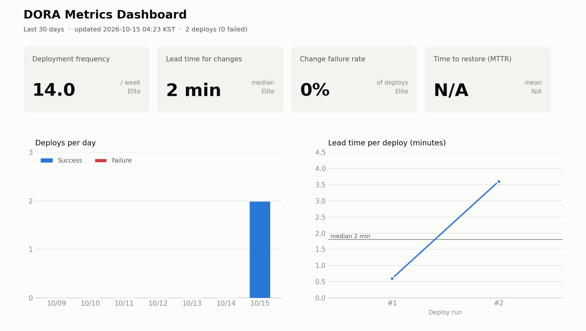

# ossproject

<!-- DORA:START -->
## 📊 DORA 지표 (자동 갱신)

> 최근 갱신: 2026-10-15 19:54 KST · [최신 주간 보고서](reports/weekly-2026-W42.md) · [원본 JSON](metrics/dora-latest.json)

| 지표 | 값 | 성과 등급 | 지난 측정 대비 |
|---|---|---|---|
| 🚀 배포 빈도 (Deployment Frequency) | **35.0회 / 주** | 🟢 Elite | ▲ 7.0회 (개선) |
| ⏱️ 변경 리드타임 (Lead Time for Changes) | **2 min** (중앙값) | 🟢 Elite | 변화 없음 |
| 💥 변경 실패율 (Change Failure Rate) | **16.7%** | 🟡 Medium | ▼ 3.3%p (개선) |
| 🛠️ 평균 복구 시간 (MTTR) | **1 min** | 🟢 Elite | 변화 없음 |
<!-- DORA:END -->

<!-- AGILE:START -->
## 🏃 애자일 지표 (자동 갱신)

> 최근 갱신: 2026-10-15 20:02 KST · [최신 애자일 보고서](reports/agile-2026-W42.md) · [원본 JSON](metrics/agile-latest.json)

| 지표 | 값 | 설명 |
|---|---|---|
| ⏱️ Cycle Time | **0 min** (중앙값) · 평균 0 min | 이슈 생성 → 완료까지 걸린 시간 |
| 🏃 Velocity | **스프린트 1: 10pt** (진행 중) | 2주 스프린트마다 끝낸 Story Point |
| 🔥 Burndown · M1 · 기반 구축 + AI 대화 | **29%** 완료 (10/34pt, D-31) | 🟢 계획보다 10pt 앞섬 |
| 🔥 Burndown · M2 · 감정 기록 + 위기 감지 + 배포 | **0%** 완료 (0/21pt, D-59) | 🟢 계획보다 0pt 앞섬 |
<!-- AGILE:END -->
