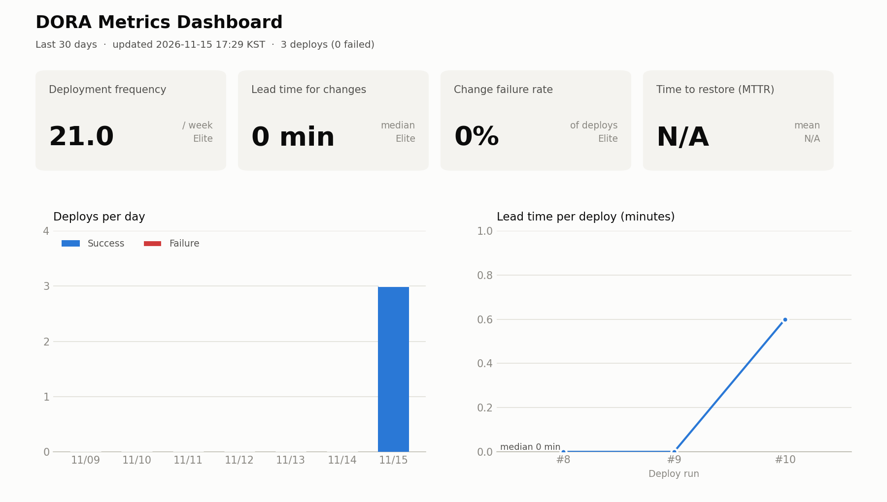

# 🌱 마으미 (Maeumi)

> **AI 기반 마음 돌봄 & 감정 기록 앱** — 하루의 마음을 AI와 대화하며 털어놓고, 감정 변화를 스스로 돌아볼 수 있게 돕습니다.

[](LICENSE)
[](CONTRIBUTING.md)
[](https://github.com/hwsseo/ossproject/wiki)

## ✨ 핵심 기능
| 기능 | 설명 |
|---|---|
| 🗣️ AI 마음 대화 | Gemini Flash 기반 공감 대화, 실패 시 기본 응답으로 자동 대체 |
| 📊 감정 기록 & 주간 리포트 | 감정 분포·변화 그래프, 고민 키워드, 한 줄 회고 |
| 🆘 위기 신호 감지 | 위험 표현 감지 시 109·1577-0199 등 도움 기관 안내를 우선 표시 |

## 🧰 기술 스택
Flutter · FastAPI · SQLite · Google Gemini API · GitHub Actions · Docker

## 🚀 빠른 시작
```bash
git clone https://github.com/hwsseo/ossproject.git
cd ossproject
python -m pip install pytest
python -m pytest -q
```
자세한 안내는 Wiki의 [Getting Started](https://github.com/hwsseo/ossproject/wiki/Getting-Started)를 참고하세요.

## 📁 프로젝트 구조
```
server/     FastAPI 서버 (safety/: 위기 감지)
tests/      pytest 테스트
scripts/    DORA·애자일 지표 수집 스크립트
reports/    자동 생성 주간 보고서
.github/    워크플로우 · 이슈/PR 템플릿
```

## 🤝 기여하기
- 작업 흐름·커밋 규칙·리뷰 태그: [CONTRIBUTING.md](CONTRIBUTING.md)
- 모두가 지키는 약속: [CODE_OF_CONDUCT.md](CODE_OF_CONDUCT.md)
- 문서: [Wiki](https://github.com/hwsseo/ossproject/wiki) · 버그/제안: [Issues](https://github.com/hwsseo/ossproject/issues)

## 📄 라이선스
[MIT License](LICENSE) © 2026 Seohyeon Hwang

---


<!-- DORA:START -->
## 📊 DORA 지표 (자동 갱신)

> 최근 갱신: 2026-11-09 13:50 KST · [최신 주간 보고서](reports/weekly-2026-W46.md) · [원본 JSON](metrics/dora-latest.json)



| 지표 | 값 | 성과 등급 | 지난 측정 대비 |
|---|---|---|---|
| 🚀 배포 빈도 (Deployment Frequency) | **1.6회 / 주** | 🔵 High | ▼ 0.6회 (악화) |
| ⏱️ 변경 리드타임 (Lead Time for Changes) | **4 min** (중앙값) | 🟢 Elite | 변화 없음 |
| 💥 변경 실패율 (Change Failure Rate) | **14.3%** | 🔵 High | 변화 없음 |
| 🛠️ 평균 복구 시간 (MTTR) | **1 min** | 🟢 Elite | 변화 없음 |
<!-- DORA:END -->

<!-- AGILE:START -->
## 🏃 애자일 지표 (자동 갱신)

> 최근 갱신: 2026-11-09 15:07 KST · [최신 애자일 보고서](reports/agile-2026-W46.md) · [원본 JSON](metrics/agile-latest.json)


| 지표 | 값 | 설명 |
|---|---|---|
| ⏱️ Cycle Time | **0 min** (중앙값) · 평균 0 min | 이슈 생성 → 완료까지 걸린 시간 |
| 🏃 Velocity | **스프린트 3: 0pt** (진행 중) · 평균 5pt | 2주 스프린트마다 끝낸 Story Point |
| 🔥 Burndown · M1 · 기반 구축 + AI 대화 | **29%** 완료 (10/34pt, D-6) | 🔴 계획보다 17pt 뒤처짐 |
| 🔥 Burndown · M2 · 감정 기록 + 위기 감지 + 배포 | **0%** 완료 (0/21pt, D-34) | 🔴 계획보다 9pt 뒤처짐 |
<!-- AGILE:END -->
