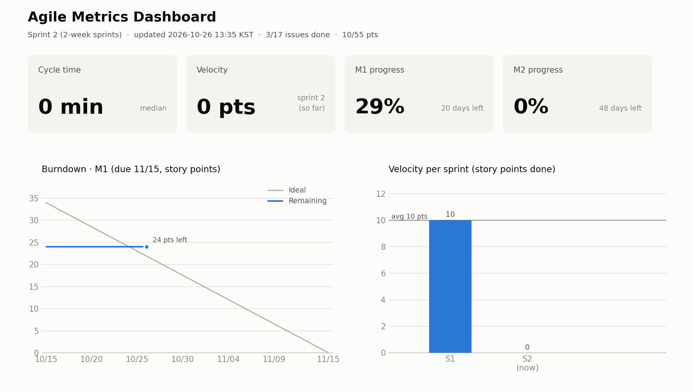

# 🏃 애자일 주간 보고서 — 2026년 44주차

> 스프린트 2 (2026-10-26 ~ 2026-11-08) · 생성: 2026-10-26 13:35 KST · 자동 생성 (GitHub Actions)

## 1. 핵심 지표

| 지표 | 값 | 설명 |
|---|---|---|
| ⏱️ Cycle Time | **0 min** (중앙값) · 평균 0 min | 이슈 생성 → 완료까지 걸린 시간 |
| 🏃 Velocity | **스프린트 2: 0pt** (진행 중) · 평균 10pt | 2주 스프린트마다 끝낸 Story Point |
| 🔥 Burndown · M1 · 기반 구축 + AI 대화 | **29%** 완료 (10/34pt, D-20) | 🟡 계획보다 2pt 뒤처짐 |
| 🔥 Burndown · M2 · 감정 기록 + 위기 감지 + 배포 | **0%** 완료 (0/21pt, D-48) | 🔴 계획보다 4pt 뒤처짐 |

## 2. 스프린트별 Velocity

| 스프린트 | 기간 | 완료 이슈 | 완료 포인트 |
|---|---|---|---|
| S1 | 2026-10-12 ~ 2026-10-25 | 3 | 10pt |
| S2 (진행 중) | 2026-10-26 ~ 2026-11-08 | 0 | 0pt |

## 3. 완료된 이슈 (Cycle Time)

| 이슈 | 포인트 | 완료일 | Cycle Time |
|---|---|---|---|
| [#3](https://github.com/hwsseo/ossproject/issues/3) [CI] DORA 4대 지표 자동 수집 파이프라인 | 5 | 10-15 | 0 min |
| [#2](https://github.com/hwsseo/ossproject/issues/2) [Docs] 프로젝트 제안서 작성 (문제정의·핵심 기능·기술 스택·마일스톤) | 3 | 10-15 | 0 min |
| [#1](https://github.com/hwsseo/ossproject/issues/1) [Chore] Git/GitHub 개발 환경 구축 (SSH 키·저장소·첫 커밋) | 2 | 10-15 | 0 min |

## 4. 해석 및 다음 스프린트 액션

- M2이 계획보다 늦습니다 → 우선순위 high 이슈부터 처리하고, 큰 이슈(5pt 이상)는 쪼개기

---
`scripts/agile_metrics.py`가 이슈 기록을 분석해 자동으로 생성했습니다. Cycle Time은 이슈 생성 시각부터 완료(Closed) 시각까지로 계산합니다.
