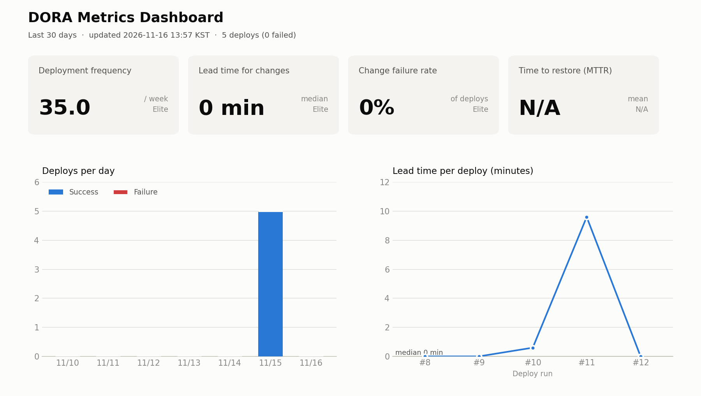

# 📊 DORA 주간 보고서 — 2026년 47주차

> 기간: 2026-11-16 ~ 2026-11-22 · 생성: 2026-11-16 13:57 KST · 계산 범위: 최근 30일 · 자동 생성 (GitHub Actions)

## 1. 핵심 지표

| 지표 | 값 | 성과 등급 | 지난 측정 대비 |
|---|---|---|---|
| 🚀 배포 빈도 (Deployment Frequency) | **35.0회 / 주** | 🟢 Elite | 변화 없음 |
| ⏱️ 변경 리드타임 (Lead Time for Changes) | **0 min** (중앙값) | 🟢 Elite | 변화 없음 |
| 💥 변경 실패율 (Change Failure Rate) | **0.0%** | 🟢 Elite | 변화 없음 |
| 🛠️ 평균 복구 시간 (MTTR) | **N/A** | ⚪ N/A | — |

- 전체 배포 **5회** (성공 5 · 실패 0), 복구 0회

## 2. 이번 주 배포 기록

이번 주에는 배포가 없었습니다.

## 3. 해석 및 다음 주 액션

- 모든 지표가 양호합니다 → 현재 흐름을 유지하며 기능 개발 속도를 높이기

---
이 보고서는 `scripts/dora_metrics.py`가 Deploy 워크플로우 기록을 분석해 자동으로 생성했습니다.
